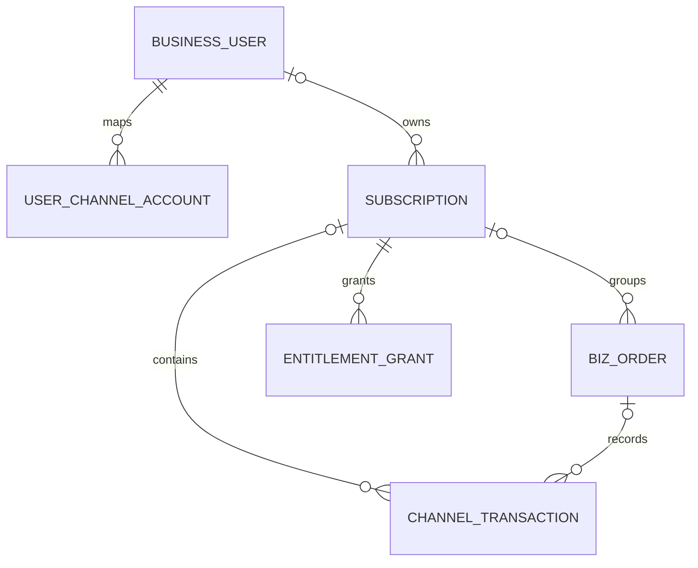

“这个用户有没有对应的交易流水”，可以落到一条明确的查询关系：`userId → subscription → channel_transaction → biz_order`。`appAccountToken` 帮助建立账户映射，`originalTransactionId` 关联 Apple 订阅链，`transactionId` 标识一笔交易；权益则独立保存为可重算的投影。

## 表的职责与关系

| 表 | 一行表示什么 | 关键关联 |
|---|---|---|
| `user_channel_account` | 某应用中一个业务账户的渠道账户映射 | `user_id ↔ app_account_token` |
| `subscription` | 一条订阅关系及其当前归属 | `original_transaction_id → user_id` |
| `biz_order` | 一次购买意图或一期业务账单 | `subscription_id` |
| `channel_transaction` | 一笔已验真的渠道交易 | `subscription_id + biz_order_id` |
| `entitlement_grant` | 一条订阅来源授予某种权益的当前投影 | `subscription_id + entitlement_code` |



`BUSINESS_USER` 是已有账号域中的实体，不要求与支付表位于同一数据库。已验真的交易可以先保存为待认领状态，所以部分外键关系允许为空。示例用逻辑关联，不隐含跨服务外键或分布式事务。

## SQL 的适用范围

以下五张主表以 **Apple 普通自动续费、一个关系同一时点一个主商品、用户级权益** 为例。Google token 谱系的扩展见后文；多 line item、角色服区权益、分期、税费、优惠和完整财务账本需要相应明细表。

时间用 UTC、区间采用 `[valid_from, valid_until)`。渠道不透明 ID 使用区分大小写的 ASCII 排序规则。`app_id` 表示平台内唯一的应用／租户命名空间，生产与沙箱在渠道事实唯一键中隔离。`id` 由平台 ID 服务或数据库策略生成。

### 账户映射表

```sql
CREATE TABLE user_channel_account (
  id BIGINT UNSIGNED NOT NULL PRIMARY KEY,
  app_id BIGINT UNSIGNED NOT NULL,
  user_id BIGINT UNSIGNED NOT NULL,
  channel VARCHAR(16) CHARACTER SET ascii COLLATE ascii_bin NOT NULL,
  app_account_token CHAR(36) CHARACTER SET ascii COLLATE ascii_bin NOT NULL,
  created_at DATETIME(3) NOT NULL,
  UNIQUE KEY uk_user_account (app_id, channel, user_id),
  UNIQUE KEY uk_account_token (app_id, channel, app_account_token)
) ENGINE=InnoDB DEFAULT CHARSET=utf8mb4;
```

这个示例表用于 Apple 账户 token。服务端为用户生成并保存 UUID，购买时由客户端通过 StoreKit 传入；token 不是用户可自行指定的任意字符串。稳定账户映射可以被多次购买复用，所以不能用它区分两张并发首购订单。Google 的混淆账户标识另设适合长度的字段或独立映射表，不能强塞进 `CHAR(36)`。

### 订阅关系表

```sql
CREATE TABLE subscription (
  id BIGINT UNSIGNED NOT NULL PRIMARY KEY,
  app_id BIGINT UNSIGNED NOT NULL,
  user_id BIGINT UNSIGNED NULL,
  channel VARCHAR(16) CHARACTER SET ascii COLLATE ascii_bin NOT NULL,
  environment VARCHAR(16) CHARACTER SET ascii COLLATE ascii_bin NOT NULL,
  original_transaction_id VARCHAR(128) CHARACTER SET ascii COLLATE ascii_bin NULL,
  current_product_id VARCHAR(128) NOT NULL,
  channel_status VARCHAR(40) NOT NULL,
  auto_renew_enabled TINYINT NULL,
  current_period_start DATETIME(3) NULL,
  current_period_end DATETIME(3) NULL,
  version BIGINT UNSIGNED NOT NULL DEFAULT 0,
  updated_at DATETIME(3) NOT NULL,
  UNIQUE KEY uk_channel_relation
    (app_id, channel, environment, original_transaction_id),
  KEY idx_user_subscription (app_id, user_id, channel, environment)
) ENGINE=InnoDB DEFAULT CHARSET=utf8mb4;
```

Apple 关系落库时，业务校验要求 `original_transaction_id` 有值。这里允许 NULL 是为其他渠道预留；MySQL 的含 NULL 唯一键不能保证 Google 关系唯一，Google 必须另用 token 登记约束。`user_id IS NULL` 表示尚未确认业务归属；一旦归属确定，普通恢复请求不得覆盖其他账户。

`auto_renew_enabled` 与当前可访问状态分开保存；未知续费偏好可为 NULL。取消下一期续费，不等于当前周期立刻到期。`current_period_end` 是关系投影，不能代替每一期交易历史。

### 业务订单表

```sql
CREATE TABLE biz_order (
  id BIGINT UNSIGNED NOT NULL PRIMARY KEY,
  order_id VARCHAR(64) CHARACTER SET ascii COLLATE ascii_bin NOT NULL,
  app_id BIGINT UNSIGNED NOT NULL,
  user_id BIGINT UNSIGNED NOT NULL,
  subscription_id BIGINT UNSIGNED NULL,
  order_type VARCHAR(24) NOT NULL,
  product_id VARCHAR(128) NOT NULL,
  payment_status VARCHAR(32) NOT NULL,
  created_at DATETIME(3) NOT NULL,
  UNIQUE KEY uk_order_id (order_id),
  KEY idx_subscription_order (subscription_id, created_at, id)
) ENGINE=InnoDB DEFAULT CHARSET=utf8mb4;
```

首购可先创建 `FIRST_PURCHASE` 购买意图，此时 `subscription_id` 为空。自动续费没有客户端预订单，由后端依据已验证的当期交易创建 `RENEWAL` 账单。`CHANNEL_PURCHASE` 可用于没有预订单的商店购买。

为突出对象关系，金额、币种、成交快照、退款明细在此省略。真实支付订单必须补齐这些字段与账务模型；不要拿当前商品价格回填历史实付金额。

### 渠道交易表

```sql
CREATE TABLE channel_transaction (
  id BIGINT UNSIGNED NOT NULL PRIMARY KEY,
  app_id BIGINT UNSIGNED NOT NULL,
  channel VARCHAR(16) CHARACTER SET ascii COLLATE ascii_bin NOT NULL,
  environment VARCHAR(16) CHARACTER SET ascii COLLATE ascii_bin NOT NULL,
  transaction_id VARCHAR(128) CHARACTER SET ascii COLLATE ascii_bin NOT NULL,
  original_transaction_id VARCHAR(128) CHARACTER SET ascii COLLATE ascii_bin NOT NULL,
  app_account_token CHAR(36) CHARACTER SET ascii COLLATE ascii_bin NULL,
  subscription_id BIGINT UNSIGNED NULL,
  biz_order_id BIGINT UNSIGNED NULL,
  product_id VARCHAR(128) NOT NULL,
  purchased_at DATETIME(3) NOT NULL,
  expires_at DATETIME(3) NULL,
  revoked_at DATETIME(3) NULL,
  raw_payload_ref VARCHAR(512) NOT NULL,
  verified_at DATETIME(3) NOT NULL,
  UNIQUE KEY uk_channel_transaction
    (app_id, channel, environment, transaction_id),
  KEY idx_transaction_chain
    (app_id, channel, environment, original_transaction_id, purchased_at, id),
  KEY idx_subscription_transaction (subscription_id, purchased_at, id),
  KEY idx_transaction_order (biz_order_id)
) ENGINE=InnoDB DEFAULT CHARSET=utf8mb4;
```

这一表型明确表达 Apple 交易：`transaction_id` 做逐笔幂等，`original_transaction_id` 连接交易链。待认领交易允许暂时没有 `subscription_id` 或 `biz_order_id`。已有交易的退款／撤销更新仍需处理，不能因为交易号重复就丢弃新事实。

`raw_payload_ref` 指向受控的原始证据。生产上另存追加式事实版本或审计记录，保存来源、原文摘要、观察时间与变更原因；表中的 `revoked_at` 是便于查询的投影，不以覆盖字段代替审计。原始 payload 和 purchaseToken 不进入普通日志。

### 权益来源表

```sql
CREATE TABLE entitlement_grant (
  id BIGINT UNSIGNED NOT NULL PRIMARY KEY,
  app_id BIGINT UNSIGNED NOT NULL,
  user_id BIGINT UNSIGNED NOT NULL,
  subscription_id BIGINT UNSIGNED NOT NULL,
  entitlement_code VARCHAR(64) NOT NULL,
  access_status VARCHAR(24) NOT NULL,
  valid_from DATETIME(3) NOT NULL,
  valid_until DATETIME(3) NOT NULL,
  version BIGINT UNSIGNED NOT NULL DEFAULT 0,
  updated_at DATETIME(3) NOT NULL,
  UNIQUE KEY uk_subscription_entitlement (subscription_id, entitlement_code),
  KEY idx_user_entitlement (app_id, user_id, entitlement_code)
) ENGINE=InnoDB DEFAULT CHARSET=utf8mb4;
```

这是每个来源的当前投影，不是完整授权历史。用户在 Apple 和 Google 各有一个 VIP 来源时，按产品规则计算并集、等级或叠加；撤销其中一条不能清掉另一条。金币、道具等增量资产使用独立的履约／资产账本，不能靠覆盖 `valid_until` 防止重复发放。

如果发到游戏角色，扩展为明确的授权目标，例如 `subject_type + subject_id`，同时校验其与业务账户、游戏和服区的关系；不要把渠道账户映射误当角色映射。

## 用两期交易串起来

以下 ID 与时间都是教学示例，不是真实订单。

| 对象 | 第一期开通 | 第二期续费 |
|---|---|---|
| 业务用户 | `1001` | `1001` |
| 应用 | `10` | `10` |
| `subscription.id` | `5001` | `5001` |
| `originalTransactionId` | `T100` | `T100` |
| `transactionId` | `T100` | `T101` |
| `biz_order.id / order_id` | `9001 / O100` | `9002 / O101` |
| 周期 | 2026-10-01 至 2026-11-01 | 2026-11-01 至 2026-12-01 |

对应 `channel_transaction` 两行分别指向订单主键 `9001` 和 `9002`，但都指向订阅 `5001`。示例中首笔 `transactionId` 与链起点相同，不能据此推导所有导入或历史样本的值都相同。

第二期确认后，订阅和 VIP grant 的当前期限更新到 12 月 1 日；第一期交易仍保留。不会反复改写 `O100` 来代表第二期，也不会把 `T101` 因 `originalTransactionId` 相同而判成重复交易。

## 查询这个用户的交易流水

参数均来自服务端已校验上下文；示例使用命名占位符，需由数据库客户端绑定。

```sql
SELECT
  s.id AS subscription_id,
  s.original_transaction_id,
  t.transaction_id,
  o.order_id,
  t.purchased_at,
  t.expires_at,
  t.revoked_at
FROM subscription s
JOIN channel_transaction t ON t.subscription_id = s.id
LEFT JOIN biz_order o ON o.id = t.biz_order_id
WHERE s.app_id = :app_id
  AND s.user_id = :authenticated_user_id
  AND s.channel = :channel
  AND s.environment = :environment
ORDER BY t.purchased_at DESC, t.id DESC
LIMIT :page_size;
```

这里使用内连接表示“确实存在已关联交易”。如果需要同时显示“已有订阅但缺交易”的修复对象，另查 `subscription`，或者使用 LEFT JOIN 并显式识别 `t.id IS NULL`；不能把一行空交易当有流水。

历史翻页使用 `purchased_at + id` 作为游标。没有返回值时，再区分无本地关系、关系有但流水缺失、环境筛选错误与未认领事实，不能立刻告诉用户从未购买。

## 认领如何做到原子化

渠道验真和账户映射核验完成后，再进入短事务。首次创建关系时用 `uk_channel_relation` 处理竞争，冲突后读取既有行。未绑定关系的认领可用条件更新：

```sql
UPDATE subscription
SET user_id = :authenticated_user_id,
    version = version + 1,
    updated_at = UTC_TIMESTAMP(3)
WHERE id = :subscription_id
  AND app_id = :app_id
  AND user_id IS NULL
  AND version = :expected_version;
```

影响行数为 0 时重读：若已属于当前用户，继续恢复；若属于另一用户，返回冲突；若版本变化但仍未绑定，重新核验后重试。这条 SQL 只解决并发，不提供归属证据，不能省略前置授权判断。

交易入库、创建或关联当期订单及写入 Outbox 应位于其所属服务的同一事务。一个事务争抢渠道交易唯一键失败时，要回滚该事务里新建的订单，再读取已存在交易的处理阶段；不能留下多张孤儿续费单。

## Google token 谱系扩展

Google 的购买关系不能机械地用一个永不改变的 token 代替 Apple `originalTransactionId`。使用内部 `subscription.id` 表示逻辑关系；每个经验证 token 作为别名登记。token 改变时，依据 `linkedPurchaseToken` 和可信账户信息建立关联，并执行计划替换策略。

```sql
CREATE TABLE google_purchase_binding (
  id BIGINT UNSIGNED NOT NULL PRIMARY KEY,
  app_id BIGINT UNSIGNED NOT NULL,
  environment VARCHAR(16) CHARACTER SET ascii COLLATE ascii_bin NOT NULL,
  subscription_id BIGINT UNSIGNED NOT NULL,
  purchase_token_hash BINARY(32) NOT NULL,
  purchase_token_secret_ref VARCHAR(512) NOT NULL,
  linked_token_hash BINARY(32) NULL,
  verified_at DATETIME(3) NOT NULL,
  UNIQUE KEY uk_google_token (app_id, environment, purchase_token_hash),
  KEY idx_google_subscription (subscription_id),
  KEY idx_google_previous (app_id, environment, linked_token_hash)
) ENGINE=InnoDB DEFAULT CHARSET=utf8mb4;
```

hash 用于索引，受控存储中的原 token 用于调用 API；异常冲突需核验原值。查询返回多 line item 时，另存商品、计划、有效期与替换关系明细，不能只保留一个 `current_product_id`。上述 Apple 交易表也要改为适配 Google 的订单与明细事实模型，不要把 token 填进 `transaction_id` 当作每期流水。

正常续费可能继续使用相同 token；token 唯一约束防止重复认领，不应阻止新一期交易处理。每期账务保留实际渠道订单信息及明细；接口缺少足够账务证据时，先更新可验证的当前权益，历史财务记录留待补齐，不能伪造一笔收入。字段参考 [SubscriptionPurchaseV2](https://developers.google.com/android-publisher/api-ref/rest/v3/purchases.subscriptionsv2)。

## 五张主表以外的可靠性记录

| 记录 | 最小业务键 | 用途 |
|---|---|---|
| 通知 Inbox | 渠道、应用、环境、通知 ID | 接收去重、原文引用、处理阶段、重试计划 |
| Outbox | 业务事件键或不可变事件 ID | 与本地业务写入原子保存待发送动作 |
| 履约 ledger | 稳定 `fulfillmentKey` | 记录 CP 发货的 PENDING／UNKNOWN／SUCCEEDED |
| 查询任务 | 关系、查询类型、任务代次 | 合并查询、丢弃过期任务结果、保存分页水位 |
| 归属迁移审计 | 迁移操作 ID | 旧新账户、证据、审批或授权、未完成动作处理 |

这些键各自解决不同问题。通知 ID 不能替代交易 ID，交易 ID 不能代替周期奖励键；同一交易的新撤销事实也不应被通知去重误丢。跨分片后，本地唯一索引只保护当前分片，需要确定性路由或一致的全局登记边界。

继续阅读：[恢复购买与交易查询](./restore-purchases.md) · [生命周期与事务一致性](./lifecycle-consistency.md)。
