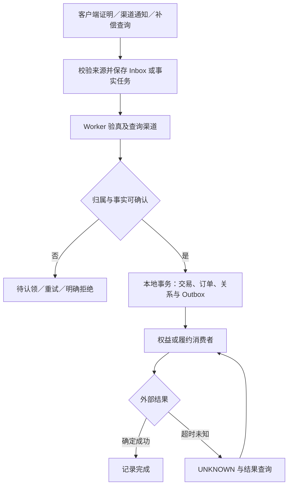

商店负责扣款和渠道购买状态，平台负责业务归属、逐期账单、权益投影与 CP 履约。首购、通知和补偿可以从不同入口到达，但必须汇入同一套事实处理逻辑。

## 首购与自动续费

| 阶段 | 首购 | 自动续费 |
|---|---|---|
| 业务意图 | 客户端可先创建业务购买意图 | 通常没有新的客户端下单 |
| 渠道购买 | 客户端调用 StoreKit／Play Billing | 商店按照订阅规则扣款 |
| 事实入口 | 客户端证明或商店通知，顺序不固定 | 通知、状态查询与交易补偿 |
| 账户定位 | 登录态、可信账户标识与既有绑定 | 已绑定订阅链或 token 谱系 |
| 业务订单 | 关联预订单或创建渠道触发账单 | 创建独立的当期账单 |
| 最终动作 | 更新 grant，按规则首次履约 | 更新 grant，按周期幂等履约 |

Apple 的 `appAccountToken` 是账户关联，不是预订单号。通知先到且用户有多个相同商品预订单时，不能只按 `productId` 猜中哪一单。可以先保留已验证交易和归属，后续通过可信绑定流程关联购买意图。

Google RTDN 用于触发查询，业务处理读取 `purchases.subscriptionsv2.get` 的当前状态和明细。新购买的 acknowledge 是购买确认，不是扣款动作；普通自动续费不要求每期再次 acknowledge。确认任务应独立重试并监控截止风险。见 [Google 购买集成](https://developer.android.com/google/play/billing/integrate) 与 [RTDN](https://developer.android.com/google/play/billing/rtdn-reference)。

## 当前权益与续费偏好

以下矩阵针对普通自动续费访问权益；分期、预付费、附加商品和家庭共享需按各自契约处理。

| 渠道情况 | 关系／偏好 | 当前来源权益 |
|---|---|---|
| 有效购买且处于有效区间 | 活跃 | 开启 |
| 用户关闭自动续费 | 下期不再续费 | 通常保留至当前已确认期限 |
| Apple 已启用且实际进入 Billing Grace Period | 扣款失败、仍在宽限 | 按确认的宽限结束时间继续访问 |
| Apple 仅处于 billing retry，无有效宽限或已付区间 | 仍尝试收款 | 不因“正在重试”自动保留访问 |
| Google grace period | 宽限期 | 继续提供对应权益 |
| Google account hold／暂停已生效 | 暂停可访问 | 停止该来源访问 |
| 购买处于 PENDING | 尚未完成 | 不按成功交易发权益 |
| 退款或撤销 | 受影响事实改变 | 核验受影响交易并重算，不清空其他独立来源 |
| 正常到期，无有效续期 | 失效 | 结束该来源访问 |

不能只比较 `expiresAt`，也不能只比较 `status == ACTIVE`。渠道状态、有效区间、撤销信息、计划替换及来源共同决定访问。Apple 宽限期参考 [Billing Grace Period](https://developer.apple.com/help/app-store-connect/manage-subscriptions/enable-billing-grace-period-for-auto-renewable-subscriptions)，Google 状态参考 [Subscription lifecycle](https://developer.android.com/google/play/billing/lifecycle/subscriptions)。

## 接收事务与业务事务分开

通知入口先做来源校验、必要验真和可靠持久化，再按协议确认接收。业务处理失败交给持久化任务重试。HTTP 成功只说明接收责任已接管，不说明订单、权益和 CP 发货全部完成。



同库模块化实现可以将订阅 grant 也纳入本地事务。若权益服务独立存储，则支付服务只原子写自己的事实和 Outbox，权益服务在自己的事务里写 Inbox 与 grant。两个数据库之间的链路不能称为一个本地事务。

## 事务伪代码

下面是边界说明，不是直接可运行的业务代码。外部验签／查询先执行，数据库锁内不等待渠道 HTTP。

```text
verifiedFacts = verifyAndQuery(proof, applicationScope)
ownership = resolveOwnership(verifiedFacts, authenticatedUser)
require ownership is established or safely claimable

transaction:
    relation = lockOrCreateRelation(verifiedFacts.relationKey)
    recheckOwnershipAndCurrentVersion(relation, ownership)
    recordNewEvidence(verifiedFacts)
    tx = insertOrLoadChannelTransaction(verifiedFacts.transactionKey)
    applyNewRevocationOrCorrectionFacts(tx, verifiedFacts)

    if tx has no business bill and bill evidence is sufficient:
        createAndBindPeriodBill(tx, relation)

    recomputeSubscriptionProjection(relation, validatedFacts)
    insertOutboxIfAbsent(stableActionKey, versionedDesiredState)
commit

worker delivers the persisted action with the same idempotency key
```

同一渠道交易已存在时，先确认账单、投影和履约阶段，不能直接返回“全部处理过”。同一交易的退款事实、缺失账单修复与重复购买通知是不同情况。

## 四层幂等

| 层次 | 业务键 | 防止的错误 |
|---|---|---|
| 接收 | `notificationUUID` 或 Pub/Sub `messageId`，带应用渠道范围 | 重复投递无限生成接收任务 |
| 交易 | Apple `transactionId`，或渠道实际交易／明细键 | 同一笔交易生成多张账单 |
| 关系认领 | Apple 链标识或 Google token 登记键 | 同一购买被两个业务账户拥有 |
| 履约 | 稳定 `fulfillmentKey`，含周期和奖励类型 | 重放重复增加金币、礼包等资产 |

Redis 锁可减少并发竞争，但数据库唯一约束和终点幂等是持久化边界。`purchaseToken` 与 `originalTransactionId` 都不是每期奖励的唯一键：关系持续存在，不意味着只有第一期需要处理。

## Outbox 与 CP 发货

Outbox 与业务状态同事务提交，发送失败可重试；消息发送成功但本地未标记成功，会重复发送。消费者必须幂等，Outbox 不提供跨商店、平台与 CP 的全局 exactly once。

CP 应把 `fulfillmentKey` 的幂等记录与资产变化放在同一个事务。平台调用超时后记录 UNKNOWN，通过相同键查询，或按 CP 契约以相同键安全重试。若 CP 既不支持幂等也不支持查询，平台本地唯一表无法消除“CP 已执行但结果丢失”的窗口。

会员访问投影可以使用版本化覆盖更新；每期金币奖励必须单独记履约流水。退款可能缩短或撤销权益，所以不能用 `max(expiresAt)` 统一处理所有事件。

## 关键崩溃窗口

| 故障位置 | 恢复依据 | 必须保持的不变量 |
|---|---|---|
| Inbox 落库后，Worker 未处理 | 待处理任务与原文引用 | 重启后仍可继续 |
| 业务事务提交前 | 数据库回滚与源事件 | 不留下部分成功账单 |
| 事务提交后，Outbox 尚未发送 | 未完成 Outbox | 发送意图不丢 |
| 消息已发送，Outbox 未标记 | 消费方幂等键 | 重复消息不重复副作用 |
| CP 已发货，响应丢失 | 相同履约键查询 | 不换键盲目补发 |
| grant 已写，缓存仍旧 | 权益版本与可靠失效事件 | 撤销延迟可度量、旧更新不覆盖新版本 |

继续阅读：[补偿与跨区可靠性](./reliability.md) · [题库第 19 至 24 题](./interview.md#幂等与事务一致性)。
