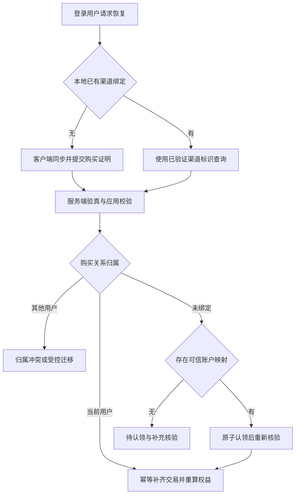

后端知道一个用户有没有交易，首先依赖自己的 **账户与购买关系映射**。如果本地从未保存映射，就需要客户端找回购买凭证，再由服务端验真和核验归属。不能向 Apple 或 Google 传平台 `userId`，直接查询这个用户的全部商店消费。

## 三种查询能力不要混淆

| 能力 | 输入 | 能证明什么 |
|---|---|---|
| 本地流水查询 | 登录用户、app、环境、分页游标 | 本平台已保存且归属该用户的交易 |
| 渠道当前状态查询 | 经验证的交易 ID 或 purchaseToken | 查询范围内的当前订阅状态 |
| 历史事实补齐 | 渠道支持的历史入口、分页游标与过滤条件 | 对应范围的历史交易记录，不等于 CP 已发货 |

本地查不到，只能说明本地没有对应记录。当前权益列表为空，也不能证明从未购买过；历史过期购买、当前不可访问状态及查询范围都要分别考虑。

## 业务用户与渠道标识

| 标识 | 谁生成 | 用途 |
|---|---|---|
| `userId` | 平台 | 登录账户和业务授权 |
| `orderId` | 平台 | 一次购买意图或当期业务账单 |
| `appAccountToken` | 平台，UUID | Apple 购买与业务账户的关联线索，非逐笔订单号 |
| `transactionId` | Apple | 单笔交易标识 |
| `originalTransactionId` | Apple | 自动续费订阅交易链的关联标识 |
| `appTransactionId` | Apple | 同一 Apple 账户与 App 的关联标识，可作为支持接口的查询入口 |
| `purchaseToken` | Google Play | 购买验证与关系查询；计划替换等场景可能产生新 token |

账户映射只能来自可信购买流程和既有绑定。`appAccountToken` 不是 Apple 端按平台用户查全部交易的搜索参数。Apple 标识的语义见 [服务端 API 与交易标识](https://developer.apple.com/videos/play/wwdc2025/249/)；Google 查询参数见 [subscriptionsv2.get](https://developers.google.com/android-publisher/api-ref/rest/v3/purchases.subscriptionsv2/get)。

## 有本地绑定时怎样查询

1. 从登录态确定 `userId`，从已授权的应用上下文确定 `appId` 与环境。
2. 查 `subscription`，取得归属该用户的渠道关系。
3. 本地 `channel_transaction` 返回流水；需要补偿时，拿已验证的渠道标识查询商店。
4. 对查询结果做验真、应用校验、关系归属检查与幂等入账，再重算当前权益。

Apple 历史查询入口为：

```http
GET /inApps/v2/history/{anyTransactionId}
```

接口支持的交易标识包括 `transactionId`、`originalTransactionId`、`appTransactionId`。历史查询可能返回该商店账户在 App 内的其他购买，不能把整个响应都强行挂到作为查询入口的那一条订阅上。逐条检查返回的 `originalTransactionId`、商品和归属，再路由到相应关系。

按 `revision`、`hasMore` 完成分页；使用过滤条件时，后续请求保持相同条件。历史里可能含退款、撤销和已更新交易，遇到已有交易 ID 仍要检查是否有新的撤销事实。参考 [Get Transaction History](https://developer.apple.com/documentation/appstoreserverapi/get-transaction-history) 与 [HistoryResponse](https://developer.apple.com/documentation/appstoreserverapi/historyresponse)。

Google 由保存的 `purchaseToken` 调用：

```http
GET /androidpublisher/v3/applications/{packageName}/purchases/subscriptionsv2/tokens/{token}
```

这是购买状态查询，不是按业务用户列出全部订单的接口，也不是完整财务流水接口。当前权益恢复成功与历史账单补齐，应分别记录完成状态。

## 没有本地绑定时怎样恢复

Apple 客户端读取 StoreKit `Transaction.currentEntitlements`，把已验证交易的签名数据交给后端。用户主动点击“恢复购买”且需要重新同步时，可调用 `AppStore.sync()`；它可能触发系统认证，不应在每次启动时无条件调用。当前权益不覆盖所有历史购买，消耗型商品也不能按当前权益恢复后重复发放。

Google 客户端通过 `queryPurchasesAsync` 找回相应类型的当前购买，将 token 提交后端。服务端调用 `purchases.subscriptionsv2.get` 验证当前状态及账户信息，再执行认领策略。它同样不能作为“用户从未购买”的完整历史证明。



## 认领规则

| 已验证的渠道事实 | 当前业务登录状态 | 处理 |
|---|---|---|
| 关系已属于当前用户 | 相同账户 | 恢复投影，不重复首购奖励 |
| 关系已属于其他用户 | 不同账户 | 返回归属冲突，进入明确的迁移或申诉流程 |
| 未绑定，可信账户标识匹配 | 当前账户 | 通过唯一约束与条件更新原子认领 |
| 未绑定，账户标识缺失或冲突 | 只有合法交易证明 | 保存事实为待认领，不自动归给上传者 |
| 应用、环境或签名校验失败 | 任意账户 | 不授予权益，按错误类型拒绝或重试 |

`transactionId`、签名交易与 token 都不是业务登录凭证。“证明交易是真的”和“证明这笔交易属于当前游戏账户”是两个判断。家庭共享、账号合并、角色迁移需要明确产品策略，不能仅靠一个 UUID 推断授权。

## 恢复接口参考

下面是平台自定义接口示例，并非商店提供的接口：

```http
POST /v1/subscriptions/restore
Authorization: Bearer <business-session>
Idempotency-Key: <restore-request-id>
```

```json
{
  "appId": 10,
  "channel": "APPLE",
  "proof": { "signedTransactionInfo": "<JWS>" }
}
```

请求中的 `appId` 还需与登录凭证的应用权限及证明中的应用标识匹配；`userId` 由服务端登录态产生。Google 的 proof 使用 `purchaseToken`，服务端按应用配置取得 `packageName`。

| 业务结果 | 含义 |
|---|---|
| `RESTORED` | 当前权益已从可信事实恢复 |
| `NO_CURRENT_ENTITLEMENT` | 本次验证范围内无当前有效权益，不代表没有历史购买 |
| `OWNERSHIP_CONFLICT` | 关系已有其他业务账户归属 |
| `CLAIM_REQUIRED` | 缺少可确认业务归属的依据 |
| `PROCESSING` | 证明已可靠接收，后续查询或处理待完成 |
| `RETRYABLE_ERROR` | 暂时无法完成验证，客户端按协议重试 |

返回 `historySyncStatus` 与 `entitlementVersion` 可以区分“当前权益已恢复”和“历史账本仍在补齐”。相同请求键重试返回既有任务；跨请求的最终幂等仍由渠道事实键和履约键保证。

## 如何验证恢复购买

- 同一用户换设备，恢复后权益一致且收入、周期奖励不重复。
- 数据库有关系但缺一期流水，能补账并保留完成水位。
- 数据库无关系但有可信账户标识，两个并发请求仅能建立一个归属。
- 另一游戏账号上传同一凭证，触发归属冲突。
- 历史查询返回其他订阅链，逐条正确路由，不混绑到账户或订单。
- 已退款交易重放后不重新开通；空当前权益不被标记为从未购买。

## 官方参考

- [StoreKit currentEntitlements](https://developer.apple.com/documentation/storekit/transaction/currententitlements)
- [AppStore.sync](https://developer.apple.com/documentation/storekit/appstore/sync())
- [Apple 官方 Java 验签库](https://github.com/apple/app-store-server-library-java)
- [Google Billing 集成与已有购买查询](https://developer.android.com/google/play/billing/integrate)
- [Google 购买验真与账户标识](https://developer.android.com/google/play/billing/security)
